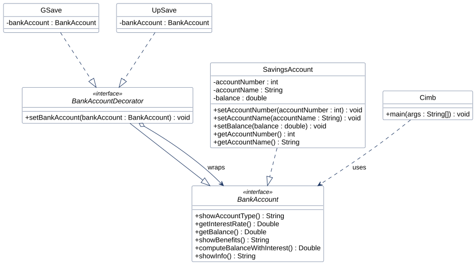

# Lab Assignment 7: Decorator Pattern

**CIMB Savings Accounts**

**Course:** CCS311-18/CSL311-18
**Author:** Alexander Campita

## Problem Statement

**Cimb with Decorator Pattern**

CIMB is a digital bank that offers GSave and UpSave savings accounts. As with a typical Savings Account, it contains accountNumber, accountName, and a balance for that account.

The typical savings account offers an interest rate of 1%.

The benefits of the typical savings account is the same with the "Standard Savings Account" as compared to other banks.

The GSave account offers an interest rate of 2.5%.

Benefits include the "Standard Savings Account" plus access to "GCash transfer".

The UpSave account offers the highest interest rate of 4.0%.

Benefits include the "Standard Savings Account" plus "with Insurance".

Develop a decorator pattern approach that will implement the given UML diagram:

```java
public class Cimb {

        public static void main(String[] args) {

                SavingsAccount account = new SavingsAccount();

                account.setAccountNumber(1234);
                account.setAccountName("Juan Dela Cruz");
                account.setBalance(10000.0);

                System.out.println(account.showInfo());
                System.out.println("Account type: " + account.showAccountType());
                System.out.println("Interest rate: " + account.getInterestRate());
                System.out.println("New balance: " + account.computeBalanceWithInterest());
                System.out.println("Benefits: " + account.showBenefits());

                System.out.println("----------------------");

                GSave gSave = new GSave(account);
                System.out.println(gSave.showInfo());
                System.out.println("Account type: " + gSave.showAccountType());
                System.out.println("Interest rate: " + gSave.getInterestRate());
                System.out.println("New balance: " + gSave.computeBalanceWithInterest());
                System.out.println("Benefits: " + gSave.showBenefits());

                System.out.println("----------------------");

                UpSave upSave = new UpSave(account);
                System.out.println(upSave.showInfo());
                System.out.println("Account type: " + upSave.showAccountType());
                System.out.println("Interest rate: " + upSave.getInterestRate());
                System.out.println("New balance: " + upSave.computeBalanceWithInterest());
                System.out.println("Benefits: " + upSave.showBenefits());

        }

}
```

Method description:

| Method | Behaviour |
|---|---|
| `showAccountType()` | Returns `"Savings Account"`, `"GSave"` or `"UpSave"` |
| `getInterestRate()` | Returns the rate per account: 1% Savings Account, 2.5% GSave, 4.0% UpSave |
| `getBalance()` | Returns the balance of the account |
| `showBenefits()` | Returns `"Standard Savings Account"`, plus `"GCash Transfer"` for GSave, plus `"With Insurance"` for UpSave |
| `computeBalanceWithInterest()` | Returns the balance plus the interest for the account's rate |
| `showInfo()` | Returns the account number, account name and balance |

`BankAccountDecorator` must be an interface. No method is added beyond the UML diagram, apart from
setters and getters.

## UML Class Diagram



PlantUML source: [docs/class-diagram.puml](docs/class-diagram.puml)

To regenerate the diagram:

```bash
java -jar plantuml.jar -tsvg docs/class-diagram.puml
```

## Project Structure

```
cimb-decorator-pattern/
├── README.md
├── docs/
│   ├── class-diagram.puml
│   ├── class-diagram.svg
│   └── class-diagram.png
└── src/
    └── cimb/
        ├── BankAccount.java
        ├── BankAccountDecorator.java
        ├── SavingsAccount.java
        ├── GSave.java
        ├── UpSave.java
        └── Cimb.java
```

## How to Build and Run

```bash
javac -d out src/cimb/*.java
java -cp out cimb.Cimb
```

## Output

```text
Account number: 1234
Account name: Juan Dela Cruz
Balance: 10000.0
Account type: Savings Account
Interest rate: 0.01
New balance: 10100.0
Benefits: Standard Savings Account
----------------------
Account number: 1234
Account name: Juan Dela Cruz
Balance: 10000.0
Account type: GSave
Interest rate: 0.025
New balance: 10250.0
Benefits: Standard Savings Account, GCash Transfer
----------------------
Account number: 1234
Account name: Juan Dela Cruz
Balance: 10000.0
Account type: UpSave
Interest rate: 0.04
New balance: 10400.0
Benefits: Standard Savings Account, With Insurance
```

## Design Summary

- `BankAccount` is the **component interface**. Both the plain account and every product variant
  implement it, so they are interchangeable wherever an account is expected.
- `SavingsAccount` is the **concrete component**: 1% interest, the standard benefits, and the only
  class that actually stores `accountNumber`, `accountName` and `balance`.
- `BankAccountDecorator` is the **decorator interface**. It extends `BankAccount` and adds a single
  hook, `setBankAccount(BankAccount)`, so a decorator can receive the account it wraps.
- `GSave` and `UpSave` are **concrete decorators**. Each holds one `BankAccount` reference and
  overrides only the behaviour that the product changes: the account type, the interest rate and
  the benefits. Everything else — balance, account details, computed interest — is delegated to the
  wrapped account.
- **Benefits compose through delegation:** `showBenefits()` calls the wrapped account first and then
  appends its own feature, which is why a GSave account reports
  `"Standard Savings Account, GCash Transfer"` without `SavingsAccount` knowing about GSave.
- **No changes to the component:** adding a new CIMB product means adding one decorator class;
  `SavingsAccount`, `Cimb` and the existing decorators stay untouched.
- **Interest is computed on the wrapped balance**, so a decorator stacked on another decorator keeps
  a single source of truth for the money in the account.
